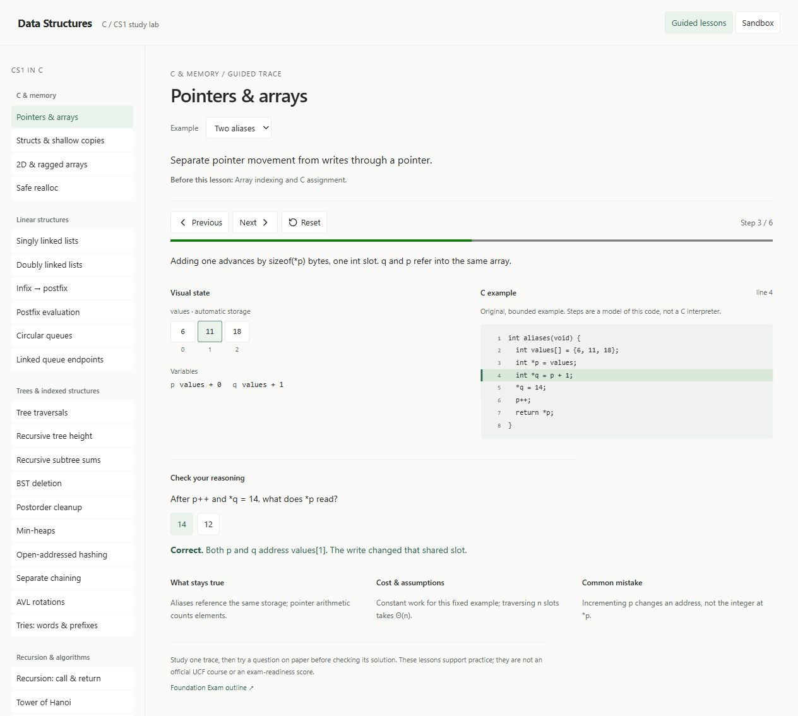

# Data Structures Visualizer

Trace C code beside a diagram of what changes at each step.

[Open the visualizer](https://cs1visualizer.vercel.app/) · [Coverage and references](docs/study-guide.md) · [Implementation notes](docs/implementation.md)



The Two aliases lesson at step 3 of 6, with the C statement highlighted beside the symbolic pointer state and a checked reasoning answer.

## The problem

A correct final answer can hide a misunderstanding of how an algorithm works. Pointer updates, recursive returns, and tree operations become easier to reason about when the code and its changing state are visible together.

This browser-based study tool pairs guided C examples with diagrams, explanations, and reasoning questions. Its scope follows the main CS1 topics in UCF's published Foundation Exam outline. The examples are original.

## Try it in one minute

1. Open a guided lesson on linked lists, recursion, or sorting.
2. Advance one step and compare the highlighted C line with the diagram.
3. Go backward to inspect the earlier state, then answer the reasoning question.
4. Switch to Sandbox and try a small input in one of the six interactive demos.

No account, API key, or local compiler is needed to use the website.

## Engineering work in this repository

The project implements lesson content, deterministic trace models, visual state renderers, playback controls, and the Sandbox demos. Tests exercise model invariants and UI behavior; a separate C check compiles and runs the teaching examples.

The recent Sandbox refactor separates the six visualizers from shared controls, samples, and utilities while keeping the entry point lazily loaded.

## Architecture

```text
Lesson catalog: goals, examples and questions
  └─ Trace models: independent state snapshots
       └─ Step player and diagram components

App
  ├─ Guided lessons
  └─ Lazy-loaded Sandbox → six visualizer modules

C examples → compiler and assertion checks
```

`src/features/lessons` owns guided content and rendering. `src/Sandbox.jsx` coordinates the original demos, with their implementation split into focused modules. `scripts/check-c-examples.js` checks the actual C examples separately from their JavaScript models.

## Key decisions and tradeoffs

- **Replay snapshots instead of undoing mutations.** Moving backward selects an earlier independent frame. This makes playback predictable, at the cost of storing each step.
- **Model the concept instead of executing arbitrary C.** Fixed inputs and symbolic memory addresses make pointer behavior visible. The diagrams are teaching models, not a C interpreter or a view of real process memory.
- **Check both representations.** JavaScript tests validate the traces; compiler checks exercise the C examples. Neither alone proves that every explanation or visual transition is correct.
- **Run entirely in the browser.** This keeps setup simple and avoids account or backend dependencies. Lesson progress resets on refresh.

## Coverage and limits

Guided material includes pointers and ownership, linked lists, stacks, queues, trees, heaps, hashing, recursion, sorting, and complexity. Sandbox includes linked lists, stacks, queues, BST operations, bubble sort, and factorial call growth.

Examples use small inputs and stated preconditions. They support practice but do not replace a course or establish exam readiness. Memory labels are symbolic; allocator behavior is represented only within the documented scenario assumptions.

## Run locally

Use Node.js 24 and npm.

```sh
git clone https://github.com/bjnorwalk/data_structures.git
cd data_structures
npm ci
npm run dev
```

Open [localhost:5173](http://127.0.0.1:5173). The first install needs an internet
connection; the app itself does not fetch external data.

## Check the project

```sh
npm run check
npm run test:c
```

`check` runs formatting, lint, tests, and the production build. `test:c` also
compiles the guided C examples with C11 warnings treated as errors and runs their
assertions. It requires clang or GCC (`CC` can select the compiler). A C compiler
is not needed to run the website. Both checks run in GitHub Actions.

Tests cover trace replay, boundary cases, tree/heap ordering, recursive results,
sorting, lesson controls, and the original sandbox operations. The C checks test
actual example functions separately from the JavaScript models. The failure path
for `realloc` uses a controlled failing allocator; successful relocation is a
visual scenario, not a promise about the allocator's address choice.

Individual commands are `npm run lint`, `npm test`, `npm run format:check`, and
`npm run build`. To serve the production build locally:

```sh
npm run build
npm run preview
```

Open [localhost:4173](http://127.0.0.1:4173). The `dist/` directory can be served by
a static host. It is build output and is not committed.

## Source

- `src/App.jsx` selects guided lessons or the lazily loaded sandbox.
- `src/features/lessons/catalog.js` defines lesson goals, examples, and questions.
- `src/features/lessons/traces/` contains deterministic models and C examples.
- `src/features/lessons/components/` renders diagrams and the step player.
- `src/Sandbox.jsx` coordinates the original demos; focused modules hold their visualizers, shared controls, samples, and utilities.
- `src/algorithms.js` and `src/hooks/use-animation-timer.js` support the sandbox.
- `scripts/check-c-examples.js` compiles and exercises the guided C examples.

Trace snapshots are independent copies. Going backward selects an earlier frame;
it does not try to undo a mutation. The browser is not a C interpreter, and memory
labels are symbolic addresses. Examples have small, fixed inputs and stated
preconditions. Some functions are intentionally restricted to keep a particular
operation visible. See [implementation notes](docs/implementation.md) before
adding a lesson.

## License

[MIT](LICENSE).
